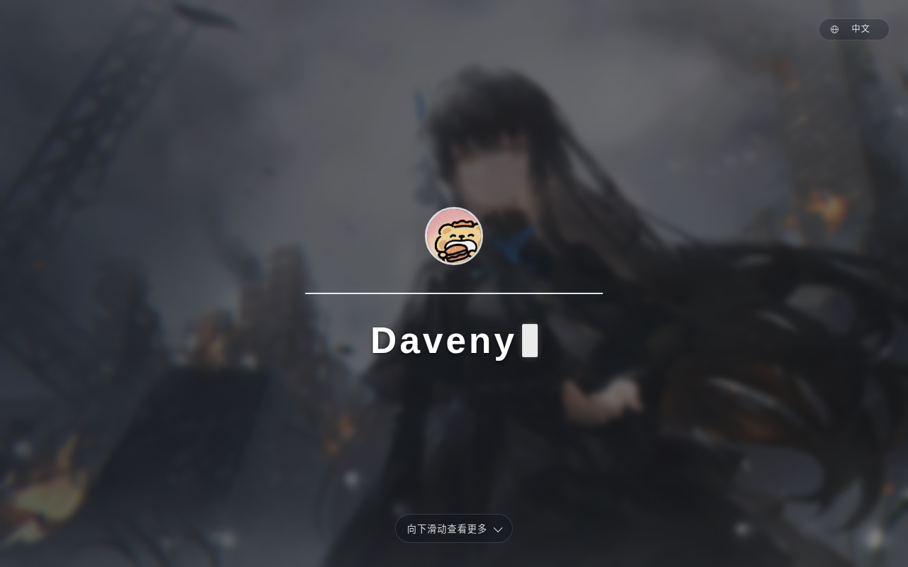

# dv-page

Daveny 的个人主页。交付物是一个静态二进制：前端产物 `go:embed` 进去，名字与头像由接口给（头像启动时读进内存），运行时不写任何文件。




| 技术栈 | 版本                       |
| ------ | -------------------------- |
| Go     | 1.27（纯标准库，无 CGO）   |
| Node   | 26                         |
| pnpm   | 12                         |
| Vue    | 3 + Vite + TypeScript      |

## 快速开始

```bash
just build      # 构建前端 → 交叉编译 amd64/arm64 到 .dist/
just run        # 本机跑起来并监听 127.0.0.1:8080
just stop       # 按端口停掉本机这份服务
```

前端开发：一个终端 `cd frontend && pnpm dev`，另一个终端 `just frontend-stub && go run .`（接口由 Go 提供，Vite 把 `/api` 代理到 `127.0.0.1:8080`）。占位 dist 只够把接口跑起来：页面 404、`/readyz` 503；要看整页就用 `just run`（它会先构建前端）。

## 命令

`just --list` 看全部；常用：

| 命令                  | 说明                                                      |
| --------------------- | --------------------------------------------------------- |
| `just build`          | 构建前端并交叉编译全部架构到 `.dist/app-<os>-<arch>`      |
| `just run`            | 先构建前端再 `go run .`，本机跑真实产物                   |
| `just stop`           | 按 `PORT` 定位本项目进程并 SIGINT                          |
| `just frontend-stub`  | 造占位 `frontend/dist/STUB`，让 `go:embed` 能编译          |
| `just check`          | 提交前：`go vet` + `go test` + 前端 `vue-tsc` 类型检查     |
| `just test`           | `go test ./... -count=1`                                  |
| `just push "信息"`    | `git add -A` + 提交 + 推送                                 |
| `just clean`          | 清掉 `.dist/` 与仓库内的 Go 缓存                          |

## 接口

| 方法 | 路径           | 说明                                                                                 |
| ---- | -------------- | ------------------------------------------------------------------------------------ |
| GET  | `/api/profile` | `{name, site:{icp, icpUrl, copyrightYear}, lang}`；带 ETag 的长缓存，一次拿全页数据   |
| GET  | `/api/avatar`  | 头像原图（二进制流）；带 ETag 与 `Accept-Ranges`，支持 304 与 Range                    |
| GET  | `/livez`       | 进程存活，不查依赖、不记日志                                                         |
| GET  | `/readyz`      | 就绪（内嵌前端产物在不在）；设了 `READYZ_TOKEN` 就必须带 `?token=`，否则 401；失败细节只进日志 |
| GET  | `/*`           | 前端静态文件；`assets/` 长缓存，其余 `no-cache`，无扩展名路径回退入口                 |

```bash
curl -s localhost:8080/api/profile | head -c 120
# {"name":"Daveny","site":{"icp":"蜀ICP备2026015939号-1","icpUrl":"https://beian.miit.gov.cn/",...
curl -sD- -o /dev/null localhost:8080/api/avatar
# Content-Type: image/jpeg / Content-Length: 483348 / ETag: "03899f23…" / Accept-Ranges: bytes
```

头像不塞进 JSON：base64 会把 483 KiB 撑成 645 KiB，还要在服务端多一次编码。分成二进制资源后，页面就是普通的 ``，浏览器按图片缓存（ETag + `max-age=86400`），服务端只做一次 `ServeContent`（顺带白拿 Range 与 304）。

错误响应统一是 `{"detail": "…"}`：文案按 `Accept-Language` 渲染，响应头带 `Content-Language` 与 `Vary: Accept-Language`；文案键只进日志，不随响应发出去。所有响应默认带 `X-Content-Type-Options: nosniff`、`Referrer-Policy: no-referrer`、`X-Frame-Options: DENY`。

`SITE_ICP` 这类配置**不是构建期变量**：前端产物是静态的（Vite 只打包，不做环境替换），后端启动时读环境变量，页面运行时从 `/api/profile` 拿到 `site.icp` 再渲染到页脚。

头像在启动时读进内存：`MY_NAME` 定名字，`AVATAR_FILE` 指头像文件（留空就用 `builtin/avatar.jpg` 那张内置图）。应用无状态、不写文件，换头像只要挂一个只读文件重启，不用重建镜像：

```bash
podman run -e MY_NAME=Daveny -e AVATAR_FILE=/etc/dv-page/avatar.png -v ./avatar.png:/etc/dv-page/avatar.png:ro dv-page
```

## 环境变量

| 变量名                   | 默认值                            | 说明                                          |
| ------------------------ | --------------------------------- | --------------------------------------------- |
| `HOST` / `PORT`          | `127.0.0.1` / `8080`              | 监听地址（必须是合法 IP）与端口（1–65535）     |
| `MAX_API_CONCURRENCY`    | `128`                             | API（含 `/livez`、`/readyz`）在途上限          |
| `MAX_STATIC_CONCURRENCY` | `64`                              | 静态文件在途上限，与 API 使用独立槽位          |
| `READYZ_TOKEN`           | 空                                | 非空时必须是 16–128 位 `[a-z0-9_]`，`/readyz` 要带 `?token=` |
| `TRUSTED_PROXIES`        | `127.0.0.1/32,::1/128`            | 可信反代段，决定是否采信 `X-Forwarded-For`    |
| `TZ`                     | `Asia/Shanghai`                   | 日志时间戳时区，无效值会拒绝启动              |
| `GOMEMLIMIT`             | 空（k8s 里给 `48MiB`）            | Go 运行时直接读取，应用不解析                 |
| `MY_NAME`                | `Daveny`                          | 主页展示的名字（也用作版权署名）              |
| `AVATAR_FILE`            | 空（用内置 `builtin/avatar.jpg`） | 头像文件路径，启动时读进内存                  |
| `SITE_ICP`               | `蜀ICP备2026015939号-1`           | 备案号                                        |
| `SITE_ICP_URL`           | `https://beian.miit.gov.cn/`      | 备案号链接，必须是绝对 http(s) URL            |
| `SITE_COPYRIGHT_YEAR`    | 当年                              | 版权年份，1970–9999                           |

配置在启动时一次性校验，不合法就直接起不来（`AVATAR_FILE` 读不到、并发上限 < 1 也是）。应用本身不写任何文件，没有 `DATA_DIR` 这类目录。页面与接口的设计写在 [DESIGN.md](DESIGN.md)。

## 测试与覆盖率

`just check` 全绿；实测覆盖率（`go test ./... -count=1 -cover`）：

| 包                  | 覆盖率 |
| ------------------- | ------ |
| `dv-page`（接线）   | 36.4%  |
| `dv-page/api`       | 96.4%  |
| `dv-page/app`       | 95.8%  |
| `dv-page/core`      | 97.6%  |
| `dv-page/httpx`     | 92.9%  |
| `dv-page/i18n`      | 97.4%  |
| 全模块合计          | 74.1%  |

前端改动后用技能自带的 `shot.mjs` 实跑浏览器截图并转发控制台错误（脚本不落在项目里；无头 Chrome 默认 `en-US`，验中文要显式设 `localStorage.lang`）：

```bash
just run &
node ~/.dsh/skills/create-lite-go-web-app/scripts/shot.mjs --url http://127.0.0.1:8080/ \
  --out .shots/hero.png --wait 4500 --pre-eval "localStorage.setItem('lang','zh-CN')" --console
```

页面里有调试入口 `window.__app`，可用 CDP 直接读 `state()`。

## 资源占用

实测环境：8 vCPU / 12 GiB 的容器、loopback 回环、压测端与被测进程同机（吞吐只作数量级参考）。压测脚本与微基准是一次性的，放在 `.shots/`（`measure.sh` / `probe.sh` / `load/` / `alloc/`），不入库。

| 项目 | 实测 |
| ---- | ---- |
| 二进制 | `linux/amd64` 9.00 MiB、`linux/arm64` 8.50 MiB（内嵌 `bg.jpg` 1.77 MiB、头像 0.46 MiB、JS 70 KiB、CSS 8 KiB） |
| 启动 | 4–8 ms 到 `/livez` 可应答 |
| 空闲 | RSS 9.4 MB（`VmHWM` = `VmRSS`） |
| 峰值 RSS | 空转 9.4 MB；`/api/profile`（134 B JSON）c=128 → 21 MB、c=512 → 43 MB、c=1024 → 75 MB；`/api/avatar`（483 KB）c=32 → 19 MB、c=128 → 28 MB、c=512 → 57 MB、c=1024 → 95 MB；1.7 MB 静态图 c=32 → 22 MB、c=512 → 55 MB |
| 页面级洪峰 | 头像 c=128 + 背景图 c=64 + 档案 c=32 同时打（两组名额全占满）→ 峰值 **40 MB**，0 个 503 |
| CPU | `/livez` 33 µs/请求；`/api/profile` 44 µs；`/api/avatar` 0.31 ms；`/readyz`（带审计日志）89 µs |
| 单次访问流量 | 首访 2.23 MiB（背景图 1.77 MiB + 头像 483 KiB + JS 71 KiB + CSS 8 KiB）；24 h 内重访约 1 KB（`/api/profile` 与 `/api/avatar` 命中 ETag 回 304，`assets/` 是 immutable 长缓存） |

峰值由三部分决定：9 MB 底噪 + 在途请求数 × 单响应开销 + 连接数。把头像从 JSON 里拆成 `/api/avatar` 之后，单响应开销基本消失（`/api/profile` 只剩 134 B，头像是 `ServeContent` 的 32 KB 拷贝缓冲），所以**在两组名额允许的范围内**（API 128 + 静态 64）页面级洪峰只到 40 MB —— 这正是 `requests.memory: 64Mi` / `limits.memory: 64Mi` / `GOMEMLIMIT: 48MiB` 这份配置的依据（阈值留四分之一给堆外开销）。

超出名额的部分不受信号量保护：连接数本身每个要 40–75 KB（`/api/avatar` c=1024 时 95 MB 里大头是 1024 条连接，而不是在途请求）。也就是说 64Mi 的预算是按「最多约 192 个在途请求 + 一小把连接」算的；如果有人把连接数打到四位数，仍会超——那属于反代该做的连接数限制。

两组上限是硬顶，超出的请求立刻 503（带 `Retry-After`），槽位互不挤占：`/api/avatar` c=1024 时 1525 个 503，而静态资源照常返回完整 1.7 MB。按约定 `/livez`、`/readyz` 算在 API 组内，所以 API 组满时探针也会 503。

## 部署

镜像由 CI 双架构构建并推送（`ghcr.io/<owner>/dv-page`，日期 + `latest` 两个 tag）。Pod 描述在 [k8s.dv-page.yaml](k8s.dv-page.yaml)：

```bash
podman kube play k8s.dv-page.yaml
```

容器以非 root 运行、`readOnlyRootFilesystem`、`drop: ALL`，不挂任何卷；探针 `/livez` 与 `/readyz?token=...` 各一。

## 目录

| 路径                  | 说明                                                       |
| --------------------- | ---------------------------------------------------------- |
| `main.go`             | 入口：读环境变量 → 建应用容器 → 挂路由 → 监听              |
| `web.go`              | `go:embed frontend/dist`，把前端产物编进二进制             |
| `api/`                | HTTP 层：路由、中间件、语言协商、探针、画像 / 站点接口、静态托管 |
| `app/`                | 用例层：启动校验、加载头像、就绪判据                       |
| `core/`               | 纯逻辑：画像与站点校验、头像读取、文件权限、恒定时间比较    |
| `httpx/`              | HTTP 小工具：JSON / 错误响应、真实客户端 IP                |
| `i18n/`               | 后端文案表与语言协商                                       |
| `builtin/`            | 随二进制发布的内置资源（默认头像）                         |
| `frontend/`           | 前端工程（pnpm + Vite + Vue + TS），产物 `frontend/dist`   |
| `internal/testenv/`   | 测试脚手架：假前端产物、假头像、现成路由                   |
| `k8s.dv-page.yaml`    | Podman Kube：ConfigMap + Pod（本应用无状态，不挂卷）        |
| `dv-page.kube`        | Quadlet Kube 模板                                          |
| `docs/`               | README 引用的截图                                          |
| `.ref/` `.prototype/` | 本地参考：模板 clone、重写前的静态页（都不入库）           |
